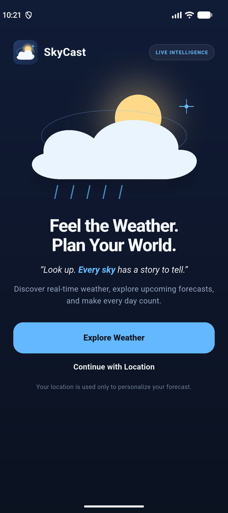
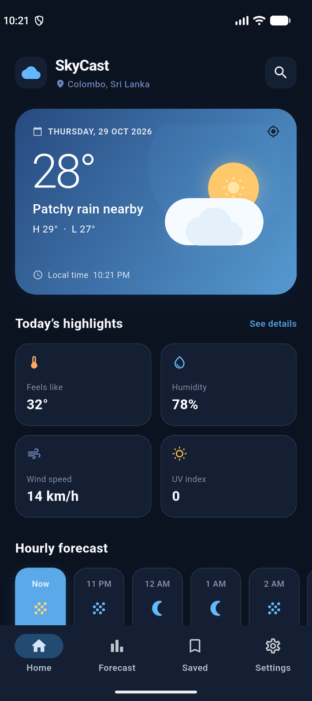
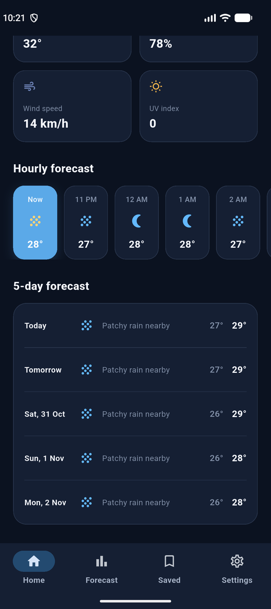
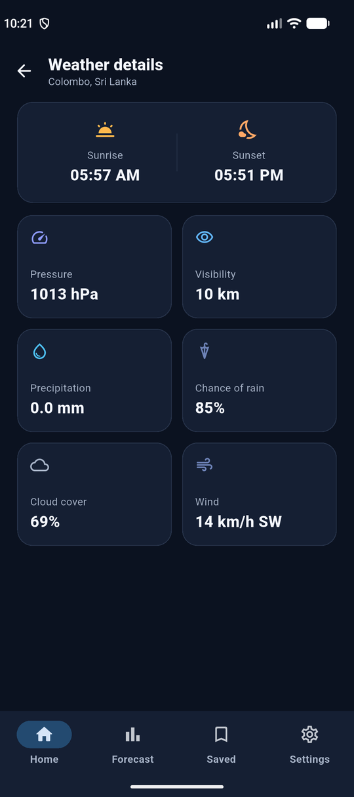
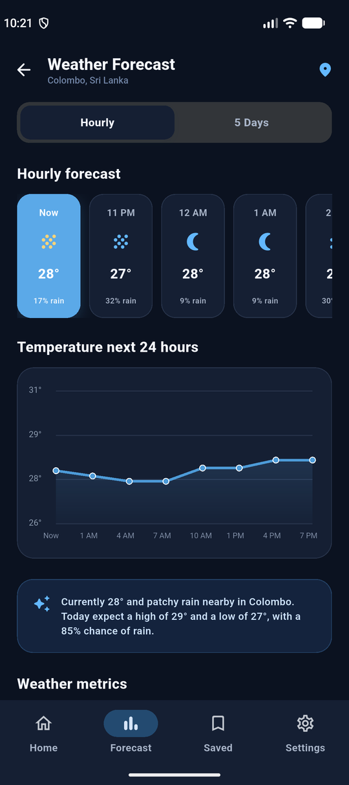
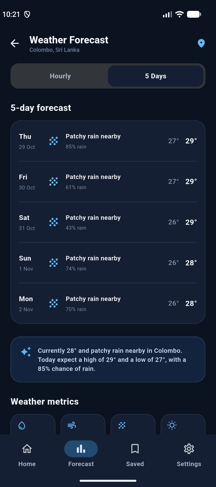
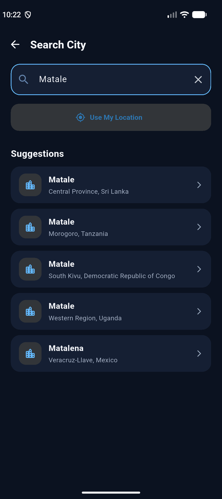
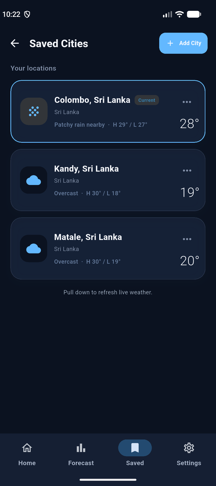
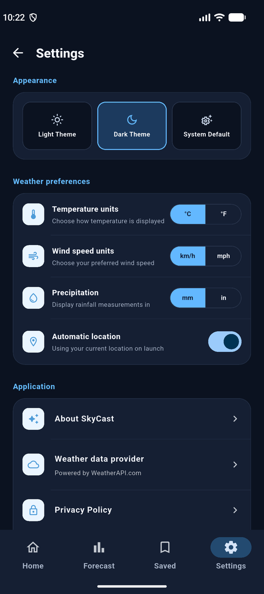
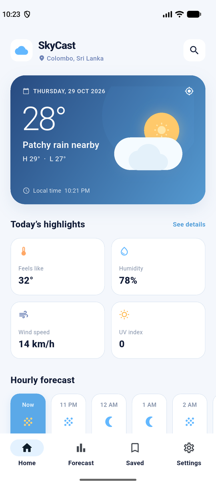

# SkyCast

<p align="center">
  
</p>

<h3 align="center">Every sky tells a story.</h3>

<p align="center">
  A calm, atmospheric weather experience for planning your day with confidence.
</p>

<p align="center">
  <a href="https://flutter.dev/"></a>
  <a href="https://dart.dev/"></a>
  <a href="https://github.com/DuminduMalinga/Sky_Cast/actions"></a>
  <a href="https://github.com/DuminduMalinga/Sky_Cast"></a>
</p>

<p align="center">
  <strong>Live conditions</strong>&nbsp;&nbsp;•&nbsp;&nbsp;
  <strong>Hourly outlook</strong>&nbsp;&nbsp;•&nbsp;&nbsp;
  <strong>5-day forecast</strong>&nbsp;&nbsp;•&nbsp;&nbsp;
  <strong>City intelligence</strong>
</p>

SkyCast is a production-oriented Flutter weather app that combines live
conditions, useful forecasts and an atmospheric visual identity. It supports
your current location or any city in the world through the
[WeatherAPI.com](https://www.weatherapi.com/) REST API.

> **Built for the glance. Designed for the journey.**

## Screenshots

<p align="center">
  
  
  
  
</p>
<p align="center">
  
  
  
  
</p>
<p align="center">
  
  
</p>

## Why SkyCast?

SkyCast turns weather data into a clear daily planning experience:

- **Know what is happening now** with temperature, condition, feels-like,
  humidity, wind, UV and high/low summaries.
- **See what is coming next** through a 24-hour temperature view and a
  focused 5-day forecast.
- **Make it personal** with saved cities, recent searches, automatic theme
  selection and configurable units.
- **Stay in control** with explicit permission flows, manual city search and
  friendly recovery states when the network or location is unavailable.

## Features

- **Live weather** for your current location (GPS, with an IP-based fallback) or a chosen city.
  Location permission is requested **once**, on first launch; after that the location is refreshed
  silently every time the app opens, and the welcome screen is shown only the first time
- **Dashboard**: temperature, condition, high/low, feels-like, humidity, wind, UV
- **Weather details**: sunrise/sunset, pressure, visibility, precipitation, chance of rain, cloud cover
- **Hourly and 5-day forecast** with a 24-hour temperature chart
- **City search** with autocomplete and recent searches; WeatherAPI results are merged with
  [Open-Meteo](https://open-meteo.com/en/docs/geocoding-api) geocoding so smaller towns are found
- **Saved cities** with live weather cards; the list is stored on the device and kept between launches
- **Settings**: light/dark/system theme, °C/°F, km/h/mph, mm/in, automatic location
  (all persisted on the device)
- **Loading, offline, server-error, city-not-found and location-permission-denied states**
  with retry and recovery paths
- Persistent bottom navigation (Home, Forecast, Saved, Settings) on every screen
- Pull-to-refresh, responsive layout, custom app icon and splash/welcome screen

## Experience highlights

| Area | What makes it feel polished |
| --- | --- |
| **Visual identity** | Midnight navy, electric blue accents, atmospheric lighting and a custom cloud-sun logo |
| **Onboarding** | Animated splash screen, calm welcome message and a clear path into the forecast |
| **Forecasting** | Fast-glance dashboard with deeper hourly, daily and detail views |
| **Accessibility** | High-contrast text, readable type scale, safe areas and clear action states |
| **Privacy** | Location is requested only after the user chooses location-based weather |
| **Resilience** | Loading, offline, server-error, city-not-found and denied-permission states |

## Modern technology suitability

SkyCast is designed as a production-oriented Flutter mobile application rather
than a static prototype. The current implementation is well suited to modern
Android and iOS devices because it uses:

- **Flutter and Dart** for a shared, strongly typed codebase with consistent
  rendering across mobile platforms
- **Material 3 theming** with light/dark/system modes, adaptive spacing,
  safe-area handling and responsive layouts for different screen sizes
- **Reusable UI components** for onboarding, weather cards, forecast views,
  search, settings and explicit loading/error states
- **Asynchronous REST networking** through `http`, with request timeouts,
  typed weather models and user-visible recovery paths for offline, server and
  invalid-city failures
- **Privacy-aware location access** through `geolocator`; permission is
  requested only when the user chooses location-based weather, with manual city
  search available when permission is denied
- **Local persistence** through `shared_preferences` for preferences, recent
  searches, saved cities and the selected theme
- **Battery-conscious motion design** using lightweight Flutter animations and
  custom painting for the atmospheric splash and welcome experience
- **Testable architecture** with injectable weather and location services,
  mocked HTTP widget tests, static analysis and formatting checks
- **Platform-ready project structure** with Android, iOS, desktop and web
  targets available through Flutter's standard build and deployment workflow

This makes the project suitable for continued modernization, including
automated release builds, crash reporting, analytics with consent, API
caching, localization and CI/CD quality gates without requiring a rewrite of
the app foundation.

## Quick start

### 1. Configure the weather API

Create a free API key at [WeatherAPI.com](https://www.weatherapi.com/), then
copy the example configuration:

```sh
cp lib/config/api_config.example.dart lib/config/api_config.dart
```

Open `lib/config/api_config.dart` and replace `YOUR_WEATHERAPI_KEY` with your
key. The configuration file is git-ignored and should never be committed.

### 2. Run SkyCast

```sh
flutter pub get
flutter run
```

On an emulator, set a location in *Extended controls → Location*, or use:

```sh
adb emu geo fix <longitude> <latitude>
```

Without a simulated location, SkyCast falls back to its default city.

## Project structure

```
lib/
  app.dart, main.dart          App shell, light/dark themes
  config/                      API base URL and key
  models/weather.dart          JSON models (current, hourly, daily, city suggestions)
  services/
    weather_service.dart       REST calls, timeouts, error mapping, city search
    location_service.dart      Permissions and device location
    city_store.dart            Current city, saved cities, recent searches
    app_settings.dart          Persisted user preferences
  screens/                     Onboarding, home, details, forecast, search, saved, settings, states
  utils/format.dart            Unit conversion and formatting
tool/                          App icon generator (see below)
test/widget_test.dart          Widget tests with a mocked HTTP client
docs/screenshots/              Screenshots used in this README
```

## Error handling

`WeatherService` maps failures to `WeatherFailure.network`, `cityNotFound` or
`server`, and the home screen shows the matching state screen with a retry
action. Requests time out after 12 seconds. The location service reports
permission denied, permanently denied and location-services-off separately.

## Tests

```sh
flutter analyze
flutter test
```

## App icon

The icon is drawn in code. To regenerate it and the platform sizes:

```sh
flutter test tool/generate_icon_test.dart
python tool/build_icons.py   # requires Pillow
```

## Credits

Weather data by [WeatherAPI.com](https://www.weatherapi.com/); extra city
lookup by [Open-Meteo](https://open-meteo.com/).
